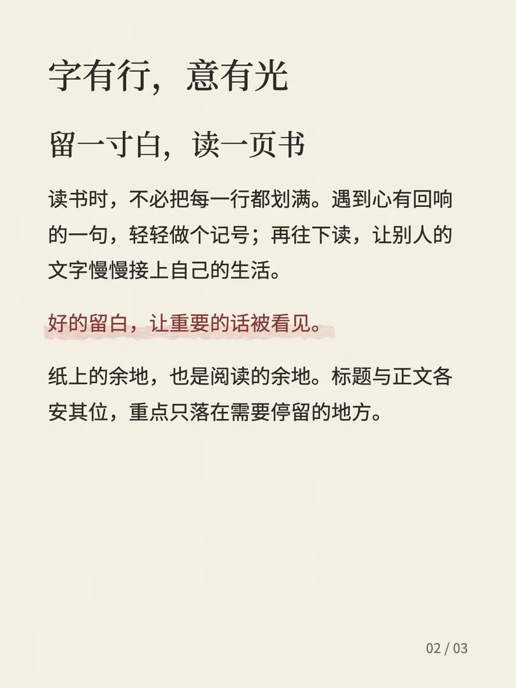
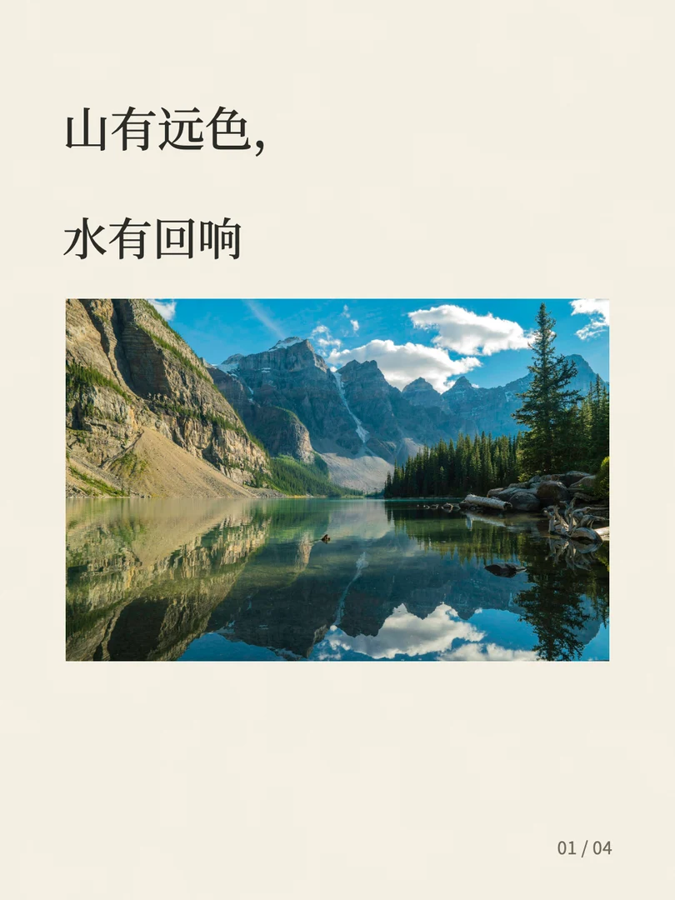

# Redleaf

Turn Markdown into paper-style Chinese reading cards. Redleaf uses warm paper, dark ink, and soft highlights while preserving your original text for reading on a phone.

 

## Install

Install with the [Skills CLI](https://github.com/vercel-labs/skills) and choose your agent:

```sh
npx skills add blainehuang1028/redleaf-skill --skill redleaf
```

The default installation is project-local. Add `-g` for a global installation or `-a codex` to select Codex. To pin a version:

```sh
npx skills add https://github.com/blainehuang1028/redleaf-skill/tree/v0.1.1/skills/redleaf
```

You can also download the [skill ZIP](https://github.com/blainehuang1028/redleaf-skill/releases/latest/download/redleaf-skill.zip) and place the `redleaf` folder in your agent's skills directory. Start with [SKILL.md](skills/redleaf/SKILL.md). No social account connection is needed.

## Use

After installation, give your agent the source document and this instruction:

> Use Redleaf to typeset this Markdown. Preserve the original text, use the cinnabar theme, and export 3:4 images and a preview.

Initial setup requires Node.js 22 or newer. Your agent can prepare the dependencies using the skill instructions. You can also run these commands inside the installed `redleaf` directory:

```sh
npm ci
npm run fonts
npx playwright install chromium
node scripts/render.mjs examples/article.md --out ./my-first-redleaf
```

Fonts are downloaded from pinned source commits and checked against SHA256 hashes. After setup, documents using local images can render offline. The output directory must be new.

## Output and layout

- Preserve text order, links, original images, and whitespace in code.
- Choose one of five themes for the document: cinnabar, blue, green, ochre, or yellow.
- Paginate paragraphs, nested lists, tables, and code. Split tall screenshots proportionally while preserving the full original image.
- Export numbered 1080×1440 PNGs, a responsive preview, text HTML, the source Markdown, original images, configuration, an asset manifest, and QA results.

Redleaf does not automatically add branding or AI watermarks. Paper textures and brush marks are drawn locally. Footers contain page numbers by default, with an optional author credit. Existing marks inside source images remain intact.

Math and Mermaid are not executed automatically. Raw HTML is displayed safely as text. If a table row cannot fit, rendering stops with a request to adjust the content instead of producing a clipped image. Redleaf does not invent illustrations or add a conclusion that is absent from the source.

## Typesetting system

- [Design system](skills/redleaf/references/design-system.md): typography, spacing, paper, brush marks, and content routing.
- [Color system](skills/redleaf/references/color-system.md): pigments, text colors, and highlights.
- [Design tokens](skills/redleaf/assets/tokens.json): shared values used to generate CSS.
- [System samples](skills/redleaf/examples/system/index.html): switchable themes with covers, body text, quotes, steps, tables, long prompts, and images.
- [Rendering reference](skills/redleaf/references/rendering.md): covers, images, manual page breaks, local brush marks, and offline layout adjustments.
- [Website source](website/index.html): exported samples, installation instructions, and usage guidance. It can be deployed as a standalone static site.

## Development and verification

```sh
cd skills/redleaf
npm ci
npm run fonts
npx playwright install chromium
cd ../..
node tests/regression.mjs output/release
node scripts/package.mjs
```

Regression checks cover five themes, long documents, real images, nested numbering, linked tall screenshots, headings with images, empty-document rejection, and concurrent font installation. Tests require a new output directory. See [website/README.md](website/README.md) for website asset builds and deployment instructions.

After editing `assets/tokens.json`, run `node scripts/build-tokens.mjs` from the skill directory. Automated checks do not replace visual review: inspect both the mobile-width preview and full-size PNGs.

## License and sources

Original code is licensed under [MIT](LICENSE). Source Han Serif, Source Han Sans, and Noto Sans Mono use the bundled SIL OFL 1.1 licenses.

The product philosophy was inspired by [Kami / tw93](https://kami.tw93.fun/index-zh.html). Redleaf independently implements image pagination and paper-and-ink effects. Colors reference [Zhongguose](https://zhongguose.com/) and [Dongfangse](https://www.2kil.com/) as digital references, without claiming a unique historical standard.

Photography samples use a licensed image by [Mark Koch / Unsplash](https://unsplash.com/photos/river-near-mountains-KiRlN3jjVNU). See the [asset records](tests/fixtures/SOURCES.json) and [sources and reuse boundaries](skills/redleaf/references/sources.md).
